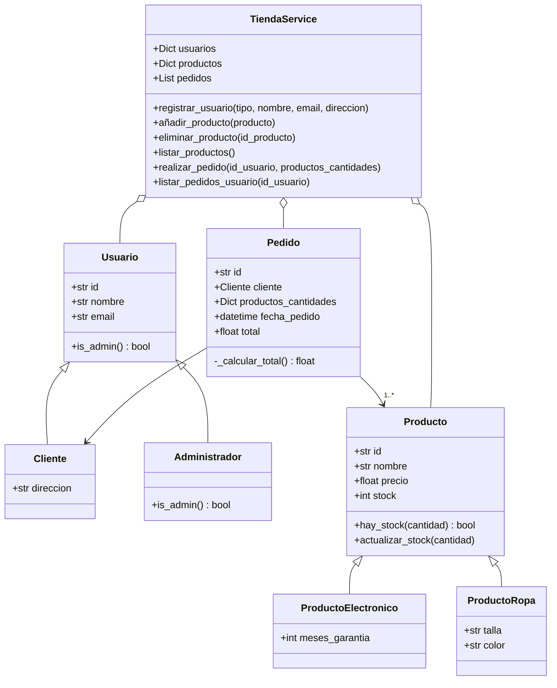

# 🛒 Tienda Online

**Autor:** Óscar Luaces ([@oscarluaces](https://github.com/oscarluaces))
**Asignatura:** Arquitectura del Software — Universidad Intercontinental de la Empresa (UIE)


## 📖 Descripción

Aplicación de consola en Python que simula la lógica de negocio de una tienda online,
diseñada con **Programación Orientada a Objetos**. Permite gestionar usuarios (clientes y
administradores), un inventario de productos de distintas categorías y la realización de
pedidos con control de stock.

El proyecto separa el **modelo de dominio** (`models/`) de la **capa de servicio**
(`Services/`), de forma que la lógica pueda reutilizarse más adelante cuando la aplicación
evolucione a una **API REST con FastAPI**.

## ✨ Funcionalidades

- **Gestión de usuarios:** registro de clientes (con dirección postal) y administradores.
- **Catálogo de productos:** productos genéricos y dos especializaciones mediante herencia:
  - `ProductoElectronico`, con meses de garantía.
  - `ProductoRopa`, con talla y color.
- **Inventario:** alta, baja y listado de productos.
- **Pedidos:** creación de pedidos con varias líneas, con estas validaciones:
  - el usuario existe y es un **cliente** (los administradores no pueden comprar);
  - los productos existen y hay **stock suficiente** de cada uno.
- **Actualización de stock** automática al confirmar un pedido, con cálculo del importe total.
- **Histórico de pedidos** por usuario, ordenado por fecha.

## 🗂️ Estructura del proyecto

```
tienda-online/
├── main.py                    # Punto de entrada: simulación completa de la tienda
├── models/                    # Modelo de dominio
│   ├── Usuario.py             # Usuario, Cliente, Administrador
│   ├── Producto.py            # Producto, ProductoElectronico, ProductoRopa
│   └── Pedido.py              # Pedido
└── Services/
    └── Tienda_service.py      # TiendaService: lógica de negocio centralizada
```

## 🧩 Diagrama de clases



## ▶️ Ejecución

**Requisitos:** Python 3.8 o superior. No hay dependencias externas: solo se usa la
biblioteca estándar (`uuid`, `datetime`, `typing`).

```bash
git clone https://github.com/oscarluaces/tienda-online.git
cd tienda-online
python main.py
```

En Linux o macOS puede que necesites usar `python3` en lugar de `python`.

### Qué hace `main.py`

Ejecuta una simulación completa del flujo de la tienda:

1. Registra 3 clientes y 1 administrador.
2. Da de alta 5 productos (2 electrónicos y 3 de ropa).
3. Muestra el inventario inicial.
4. Realiza 3 pedidos de distintos clientes.
5. Muestra el inventario actualizado, con el stock descontado.
6. Muestra el histórico de pedidos de un cliente.

### Ejemplo de salida

```
>>> 4. Simulando realización de pedidos...

[Simulando Pedido 1 - María]
¡Pedido realizado con éxito!
Pedido ID: 09b9e7a2... | Fecha: 2026-10-30 16:16:18 | Cliente: María López | Total: 1285.00€

>>> 5. Listando inventario tras los pedidos (Comprobación de stock actualizado)...
--- Inventario de la Tienda ---
Producto: Portátil Gaming | Precio: 1200.00€ | Stock: 9 | Garantía: 36 meses
Producto: Auriculares Inalámbricos | Precio: 89.99€ | Stock: 47 | Garantía: 24 meses
...
```

## 🛣️ Hoja de ruta

- [x] Modelo de dominio y capa de servicio en Python (POO)
- [x] Control de versiones con Git y GitHub
- [ ] Contenerización con Docker (rama `feature/docker`)
- [ ] Evolución a API REST con FastAPI

## 🌿 Flujo de trabajo con Git

- `main`: rama principal y estable, protegida. Los cambios entran solo mediante Pull Request.
- `feature/*`: una rama por funcionalidad nueva (por ejemplo `feature/docker`).
